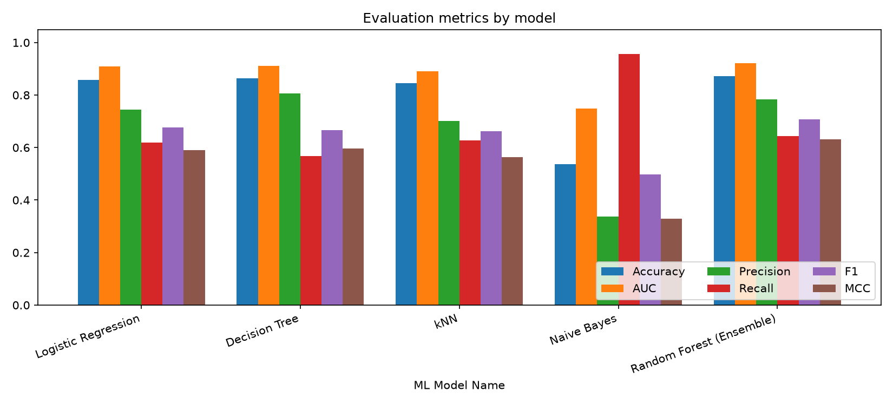
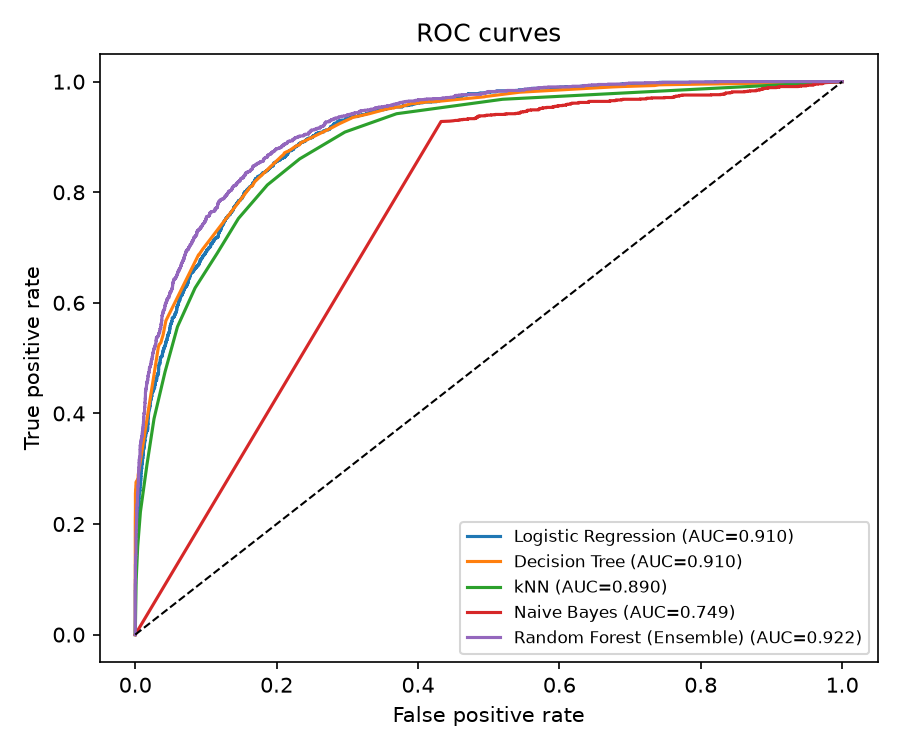
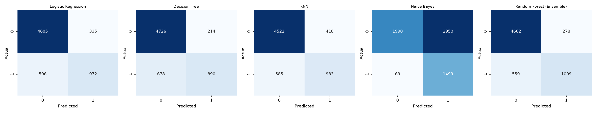

# ML Assignment 2 – Income Classification (UCI Adult Dataset)

## a. Problem Statement
Predict whether a person earns more than $50K per year (`>50K`) or not (`<=50K`) from
census attributes, by implementing and comparing five classification models on the same
dataset: Logistic Regression, Decision Tree, kNN, Gaussian Naive Bayes and Random Forest.

## b. Dataset Description  [1 mark]
- **Source:** UCI Machine Learning Repository – Adult (Census Income) dataset
  (https://archive.ics.uci.edu/dataset/2/adult)
- **Why chosen:** satisfies every requirement – 14 features (min 12), 32,561 instances (min 1,000),
  real missing values (encoded as `?`), duplicate rows, and a clearly imbalanced target.
- **Target variable:** `income` (1 = `>50K`, 0 = `<=50K`) – binary classification.
- **Feature types:** 6 numeric (`age, fnlwgt, education_num, capital_gain, capital_loss, hours_per_week`),
  8 categorical (`workclass, education, marital_status, occupation, relationship, race, sex, native_country`).
- **Missing values:** `workclass`, `occupation`, `native_country`.
- **Class distribution:** ~76% `<=50K` / ~24% `>50K` (imbalanced – hence MCC, F1 and AUC are reported
  besides accuracy). *(Paste your own printed numbers / `outputs/class_distribution.png`.)*

## c. GitHub Repository Link  [2 marks]
`<paste your repository URL here>`

## Project structure
```
project-folder/
├── requirements.txt
├── README.md
├── test_data.csv          # 20% stratified hold-out set (generated by the script)
├── model/
│   ├── ml_assignment.py   # complete source code
│   └── *.joblib           # saved pipeline for each model
└── outputs/               # metrics.csv + charts
```

## How to run
```bash
pip install -r requirements.txt
python model/ml_assignment.py
```
The dataset is downloaded automatically from UCI on first run (cached to `data/adult.csv`).
If you are offline, download `adult.data` yourself, add a header row with the 15 column names used in
the script, and save it as `data/adult.csv`.

## Preprocessing
- `?` converted to NaN; duplicate rows removed (before the split to avoid leakage).
- Numeric: median imputation + StandardScaler. Categorical: most-frequent imputation + One-Hot encoding
  (`handle_unknown="ignore"`).
- 80:20 **stratified** train/test split, `random_state=42`.
- All preprocessing sits inside a scikit-learn `Pipeline`/`ColumnTransformer`, so it is **fitted on the
  training data only**.

## Model configurations
| Model | Key parameters |
|---|---|
| Logistic Regression | `max_iter=1000` |
| Decision Tree | `max_depth=8, min_samples_leaf=20` |
| kNN | `n_neighbors=15` |
| Naive Bayes | `GaussianNB()` defaults |
| Random Forest | `n_estimators=200, min_samples_leaf=2` |

## d. Models Used – Comparison Table  [5 marks]
*(Replace with the output of your run – the script prints a ready-made markdown table and saves
`outputs/metrics.csv`.)*

| ML Model Name | Accuracy | AUC | Precision | Recall | F1 | MCC |
|---|---|---|---|---|---|---|
| Logistic Regression | | | | | | |
| Decision Tree | | | | | | |
| kNN | | | | | | |
| Naive Bayes | | | | | | |
| Random Forest (Ensemble) | | | | | | |

### Visualisations  [2 marks]




## e. Observations  [3 marks]
*(Write after seeing your results; typical points are in the right-hand column.)*

| ML Model Name | Observation about model performance |
|---|---|
| Logistic Regression | Strong linear baseline; good AUC, may miss minority-class cases. |
| Decision Tree | Easy to interpret; depth limit controls overfitting; lower AUC than ensembles. |
| kNN | Sensitive to scaling and the high-dimensional one-hot space; slowest at prediction time. |
| Naive Bayes | Independence assumption is violated by one-hot features; often high recall but low precision. |
| Random Forest (Ensemble) | Usually best overall – handles non-linearity and interactions, reduces variance. |
| **Overall Winner for your dataset?** | *(Name the model with the best MCC/AUC from your table and justify.)* |

## Screenshot  [2 marks]
Add a screenshot of the execution on BITS Virtual Lab here.
